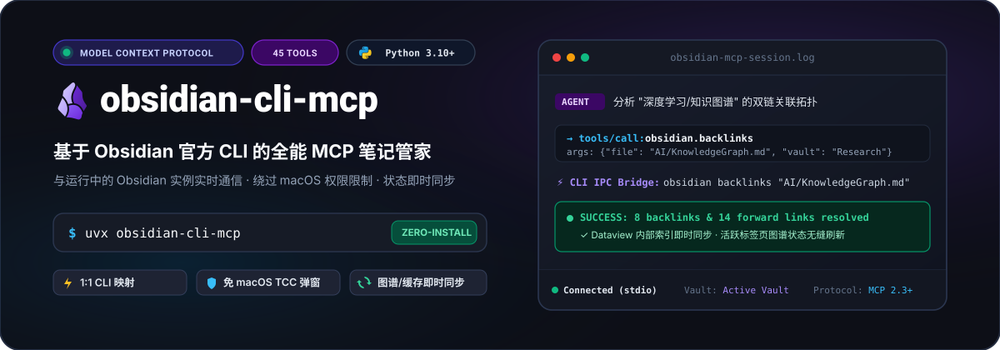
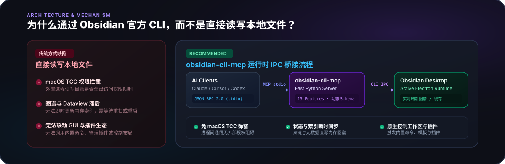
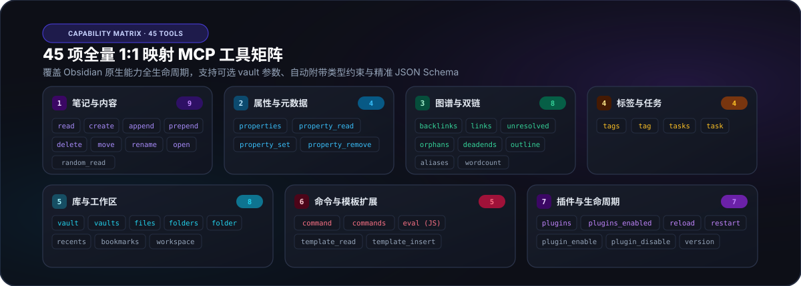

[license]: https://github.com/AkimioJR/obsidian-cli-mcp/blob/main/LICENSE
[license-badge]: https://img.shields.io/badge/License-MIT-blue.svg?style=flat-square
[python]: https://pypi.org/project/obsidian-cli-mcp
[python-badge]: https://img.shields.io/pypi/pyversions/obsidian-cli-mcp?style=flat-square&logo=python&logoColor=white
[pypi]: https://pypi.org/project/obsidian-cli-mcp
[pypi-badge]: https://img.shields.io/pypi/v/obsidian-cli-mcp?style=flat-square&logo=pypi&logoColor=white
[uv]: https://github.com/astral-sh/uv
[uv-badge]: https://img.shields.io/badge/Package-uv%20%2F%20uvx-10B981.svg?style=flat-square
[mcp]: https://modelcontextprotocol.io
[mcp-badge]: https://img.shields.io/badge/Protocol-MCP%202.3+-8B5CF6.svg?style=flat-square
[ci]: https://github.com/AkimioJR/obsidian-cli-mcp/actions/workflows/lint.yaml
[ci-badge]: https://img.shields.io/github/actions/workflow/status/AkimioJR/obsidian-cli-mcp/lint.yaml?branch=main&style=flat-square&logo=githubactions&logoColor=white&label=CI
[release]: https://github.com/AkimioJR/obsidian-cli-mcp/releases/latest
[release-badge]: https://img.shields.io/github/v/release/AkimioJR/obsidian-cli-mcp?style=flat-square
[pr]: https://github.com/AkimioJR/obsidian-cli-mcp/pulls
[pr-badge]: https://img.shields.io/badge/PRs-welcome-brightgreen.svg?style=flat-square
[issue]: https://github.com/AkimioJR/obsidian-cli-mcp/issues/new
[issue-badge]: https://img.shields.io/badge/Issues-welcome-brightgreen.svg?style=flat-square

<div align="center">
  <p>
    
  </p>

[![pypi][pypi-badge]][pypi]
[![python][python-badge]][python]
[![uv][uv-badge]][uv]
[![mcp][mcp-badge]][mcp]
[![ci][ci-badge]][ci]

[![release][release-badge]][release]
[![license][license-badge]][license]
[![pr][pr-badge]][pr]
[![issue][issue-badge]][issue]

  <p>
    <b>简体中文</b> | <a href="README_en.md">English</a>
  </p>
</div>

---

## 💡 为什么选择 obsidian-cli-mcp？

**通过 Obsidian 官方 CLI 深度整合笔记库的 MCP (Model Context Protocol) 服务器。**

许多 AI 客户端通常尝试直接读写本地磁盘上的 Markdown 文件，但在真实知识管理工作流中存在严重的系统缺陷。`obsidian-cli-mcp` 通过官方 CLI 进程间通信（IPC）桥接运行中的 Obsidian 桌面应用，彻底解决这些痛点：

<p align="center">
  
</p>

### 核心优势对比

| 考量维度             | 传统直接文件读写                          | obsidian-cli-mcp (官方 CLI IPC)                            |
| :------------------- | :---------------------------------------- | :--------------------------------------------------------- |
| **双链图谱刷新**     | ❌ 外部静默写入，图谱拓扑滞后，需手动重扫  | ✅ **即时同步**：双链、反链与孤立节点状态实时更新           |
| **Dataview 缓存**    | ❌ 内存索引无法感知变动，查询结果过时      | ✅ **即时生效**：属性（Frontmatter）修改即刻更新查询视图    |
| **macOS 隐私权限**   | ⚠️ 极易触发系统 TCC 弹窗或缺少全盘访问报错 | ✅ **零权限困扰**：与本地运行进程通信，无需额外系统授权     |
| **GUI 与活动标签页** | ❌ 无法定位当前打开文件，无法聚焦笔记      | ✅ **实时联动**：支持 `open` 聚焦活跃笔记、查看大纲等       |
| **插件与系统命令**   | ❌ 无法与 Obsidian 生态插件联动            | ✅ **深度拓展**：一键执行核心/插件命令、开关插件、JS `eval` |

---

## 🚀 快速接入 (Quickstart)

### 方式一：通过 `uvx` 运行（推荐 · 免安装开箱即用）

无需预先克隆代码或配置本地 Python 环境，`uvx` 会自动在隔离沙盒中极速拉取并启动服务。

在 Claude Desktop（`claude_desktop_config.json`）、Cursor 或 Codex（`mcp.json`）中添加配置：

```json
{
  "mcpServers": {
    "obsidian": {
      "command": "uvx",
      "args": ["obsidian-cli-mcp"],
      "env": {
        "OBSIDIAN_VAULT": "MyVault"
      }
    }
  }
}
```

> **提示**：如需直接从 GitHub 加载或锁定特定分支/版本：  
> `uvx --from git+https://github.com/AkimioJR/obsidian-cli-mcp.git obsidian-cli-mcp`

---

### 方式二：通过 `uv tool` 安装为独立工具（高频调用推荐）

使用 `uv tool install` 将其安装到独立的隔离沙盒中，既不污染宿主 Python 环境，又可获得全局命令并享受毫秒级启动响应：

```bash
uv tool install obsidian-cli-mcp
# 或直接从 GitHub 仓库安装最新分支：
# uv tool install git+https://github.com/AkimioJR/obsidian-cli-mcp.git
```

在 MCP 客户端配置中推荐使用 `uv tool run` 唤起（避免桌面端 GUI 客户端因 PATH 缺失找不到命令）：

```json
{
  "mcpServers": {
    "obsidian": {
      "command": "uv",
      "args": ["tool", "run", "obsidian-cli-mcp"],
      "env": {
        "OBSIDIAN_VAULT": "MyVault"
      }
    }
  }
}
```

> **版本升级**：后续升级只需执行：`uv tool upgrade obsidian-cli-mcp`

---

### 方式三：通过 `pip` 安装

也可以使用传统 `pip` 安装到当前 Python 环境：

```bash
pip install obsidian-cli-mcp
# 或从 GitHub 安装：
# pip install git+https://github.com/AkimioJR/obsidian-cli-mcp.git
```

在 MCP 客户端配置中直接调用该命令：

```json
{
  "mcpServers": {
    "obsidian": {
      "command": "obsidian-cli-mcp",
      "env": {
        "OBSIDIAN_VAULT": "MyVault"
      }
    }
  }
}
```

---

## 🛠️ 前置条件与环境变量

### 前置条件

1. **Obsidian 桌面端**：
   - 需要 **Obsidian v1.12.7 或更高版本**（内置官方 CLI 接口支持，详见 [Obsidian CLI 演进记录](docs/obsidian-cli-changelog.md)）；
   - 在使用本 MCP 服务时，Obsidian 桌面应用需保持运行状态。
2. **开启官方命令行界面 (Obsidian CLI)**：
   - 打开 Obsidian 桌面端，进入 **设置 (Settings)** → **关于 (About)**（部分版本位于 **常规 / General**）；
   - 找到 **命令行界面 (Command line interface)** 选项并开启；
   - 点击 **注册 / 在终端中设置 CLI (Set up CLI to work in the terminal)** 按钮，将 `obsidian` 注册到系统的 `PATH` 路径中；
   - 重启终端后执行 `obsidian version`，若成功输出版本号（如 `1.14.5 (installer 1.14.5)`）即表示就绪。

### 环境变量配置

| 环境变量              | 说明                                                                                                                   | 默认行为                                           |
| :-------------------- | :--------------------------------------------------------------------------------------------------------------------- | :------------------------------------------------- |
| `OBSIDIAN_VAULT`      | 默认操控的目标 Vault 笔记库名称（工具未显式传入 `vault` 参数时自动采用）                                               | 未设置时由 Obsidian CLI 自动绑定当前活跃库         |
| `OBSIDIAN_CLI_PATH`   | Obsidian CLI 可执行文件的绝对路径                                                                                      | 自动在系统 PATH 中探测（如 `which obsidian`）      |
| `OBSIDIAN_TIMEOUT`    | CLI 子进程命令执行超时时间（秒，支持小数浮点或 `none`/`null` 禁用超时）                                                | `30.0`                                             |
| `OBSIDIAN_VERSION`    | 手动指定或覆盖 Obsidian 客户端版本号（用于无头/容器环境兼容性校验，如 `1.14.5`）                                       | 启动时自动从 `obsidian version` 探针探测           |
| `OBSIDIAN_FEATURES`   | 按需启用的工具特性组（如 `note,property,tag,task,graph,explorer,workspace,bookmark,command,template,plugin,base,developer` 或预设 `standard,safe,all`） | `standard`（默认启用核心工具及日常笔记与图谱特性） |
| `OBSIDIAN_LANG`       | 人类可读界面与工具标题的本地化语言（支持 `zh_CN`, `en_US` 等）                                                         | 自动探测系统环境（未匹配时回退至 `en_US`）         |
| `OBSIDIAN_EXTENSIONS` | 是否启用非原生 CLI 的扩展复合工具（仅当为 `true`（不区分大小写）时开启，其余情况均为 `false`）                         | `false`（默认保持纯粹的官方 CLI 命令映射）         |

---

## 📦 支持的 MCP 工具矩阵

所有工具均支持可选的 `vault` 参数以随时跨库调用；所有参数均附带精确的 JSON Schema 描述与严密类型约束。

<p align="center">
  
</p>

<details open>
<summary><b>展开查看详细工具功能清单</b></summary>

### 🌟 基础核心工具 (Core Tools · 5 项原生 + 1 项扩展，默认无条件加载)
- `version`: 查询当前运行的 Obsidian 桌面客户端版本。
- `vaults`: 列出本机已知的所有 Vault 笔记库及绝对路径。
- `vault`: 查询当前 Vault 基本状态（名称、物理路径、文件数、体积等）。
- `reload`: 重新加载当前笔记库界面与重建索引。
- `restart`: 重启 Obsidian 桌面客户端进程。
- `set_default_vault`: 动态切换当前会话默认目标笔记库（需 `OBSIDIAN_EXTENSIONS=true`）。

### 1. 笔记与内容 (Feature: `note` · 11 项原生 + 1 项扩展)
- `read`: 按文件名或相对路径读取笔记 Markdown 原文。
- `create`: 创建新笔记，支持指定模板、预填充内容、静默覆盖与默认打开。
- `append`: 向指定笔记末尾或特定标题区域下方（`heading=`，Obsidian 1.14+）追加内容。
- `prepend`: 向指定笔记开头或特定标题区域下方（`heading=`，Obsidian 1.14+）前置插入内容。
- `delete`: 删除笔记文件（默认安全移入回收站，支持永久物理删除）。
- `move`: 移动或重命名笔记路径。
- `rename`: 重命名指定笔记文件（需 Obsidian 1.12.1+）。
- `open`: 在 Obsidian 桌面端图形界面中聚焦打开笔记。
- `random_read`: 随机读取库内的一篇笔记（漫游探索）。
- `random`: 在 Obsidian 界面中随机打开并聚焦一篇笔记。
- `diff`: 对比文件的本地历史版本或 Obsidian Sync 云端同步版本差异。
- `edit`: 局部精细编辑笔记（字面搜索替换，需 `OBSIDIAN_EXTENSIONS=true`）。

### 2. 元数据与属性 (Feature: `property` · 4 项)
- `properties`: 列出库中或指定笔记的全部属性概览。
- `property_read`: 读取笔记指定 Frontmatter 属性值。
- `property_set`: 设置属性值（支持 text、list、number、checkbox 等丰富类型）。
- `property_remove`: 移除笔记中的指定属性字段。

### 3. 图谱与双链拓扑 (Feature: `graph` · 8 项)
- `backlinks`: 获取笔记的反向链接列表（JSON 格式）。
- `links`: 获取笔记的外向链接列表。
- `unresolved`: 列出未创建实体的悬空双链（等待补全的想法）。
- `orphans`: 列出无反向链接的孤立文件。
- `deadends`: 列出无外向链接的末端文件。
- `outline`: 获取笔记的大纲标题层级结构（JSON 格式）。
- `aliases`: 列出库中或指定文件的别名列表。
- `wordcount`: 统计字数与字符数分布。

### 4. 标签管理 (Feature: `tag` · 2 项)
- `tags`: 获取所有标签及其统计分布（JSON 格式）。
- `tag`: 检索特定标签在各个笔记中的具体出现详情。

### 5. 待办任务 (Feature: `task` · 2 项)
- `tasks`: 按状态（已完成/待办）、标签或所在文件多维筛选任务。
- `task`: 切换任务的勾选完成状态。

### 6. 文件与目录资源 (Feature: `explorer` · 5 项原生 + 1 项扩展)
- `files`: 列出库内文件清单（支持按文件夹与后缀筛选）。
- `file`: 查询单个文件的元数据与系统详细信息（绝对路径、大小、创建与修改时间等）。
- `folders` / `folder`: 浏览文件夹目录树与结构详情。
- `recents`: 列出最近访问的历史文件。
- `import_file`: 导入外部本地文件至笔记库（文件流直拷，零 Token 消耗免 JSON 转义，需 `OBSIDIAN_EXTENSIONS=true`）。

### 7. 工作区与布局导航 (Feature: `workspace` · 3 项)
- `workspace`: 查询当前工作区窗口布局树。
- `tabs`: 列出当前工作区中打开的所有标签页与分屏布局。
- `tab_open`: 在 Obsidian 界面中打开新标签页（支持指定文件、标签组 ID 或视图类型）。

### 8. 书签收藏管理 (Feature: `bookmark` · 2 项)
- `bookmarks`: 查看书签与星标项目列表。
- `bookmark`: 在当前笔记库中新增书签（支持文件、块/标题子路径、文件夹、搜索查询或 URL）。

### 9. 快捷指令与命令面板 (Feature: `command` · 2 项)
- `command`: 触发执行 Obsidian 内置或第三方插件命令。
- `commands`: 列出当前可用的全部命令 ID 清单。

### 10. 模板管理与插入 (Feature: `template` · 3 项)
- `templates`: 列出当前笔记库内所有的模板文件。
- `template_read`: 读取模板文件并支持占位符变量解析。
- `template_insert`: 将模板内容插入到当前活跃笔记。

### 11. 插件扩展管理 (Feature: `plugin` · 4 项)
- `plugins` / `plugins_enabled`: 列出已安装 / 已启用的社区与核心插件。
- `plugin_enable` / `plugin_disable`: 动态启用或禁用指定插件。

### 12. 数据库表格与看板 (Feature: `base` · 4 项，需 Obsidian 1.14+)
- `bases`: 列出笔记库内所有的 `.base` 表格视图文件。
- `base_views`: 获取指定 Base 文件中已配置的视图清单。
- `base_query`: 对 Base 数据表格执行结构化查询并导出（支持 JSON、CSV、Markdown 等）。
- `base_create`: 在指定 Base 视图中快速创建新条目。

### 13. 开发者工具 (Feature: `developer` · 11 项)
- `eval`: 在 Obsidian 运行时环境中直接执行 JavaScript 代码（高级逃生通道）。
- `dev_dom`: 使用 CSS 选择器查询、过滤与提取已渲染的 DOM 元素（文本、HTML、属性、CSS 等）。
- `dev_css`: 审查匹配指定选择器的 CSS 样式规则与源定位。
- `dev_console`: 查看或清空捕获的控制台消息（Log/Warn/Error/Info/Debug）。
- `dev_errors`: 查看或清空未处理的运行时异常与崩溃日志。
- `dev_debug`: 挂载或断开 Chrome DevTools Protocol 调试器连接（`state=on|off`）。
- `dev_startup`: 输出应用冷启动各阶段的耗时分解 breakdown（支持自动解析为结构化 JSON）。
- `dev_screenshot`: 对当前 Obsidian 应用窗口进行截屏并保存为图片。
- `dev_mobile`: 开启或关闭移动端模拟视图模式（`state=on|off`）。
- `devtools`: 打开或关闭 Electron 原生开发者工具窗口（F12）。
- `dev_cdp`: 直接向底层 Electron 实例发送 Chrome DevTools Protocol 指令。

</details>

---

## 💻 本地开发与调试 (Local Development)

如果你需要对本项目进行二次开发或定制功能：

### 1. 克隆仓库与依赖同步

```bash
git clone https://github.com/AkimioJR/obsidian-cli-mcp.git
cd obsidian-cli-mcp

# 使用 uv 极速同步所有依赖（包含开发与测试工具链）
uv sync
```

### 2. 本地直接运行服务

```bash
uv run obsidian-cli-mcp
```

### 3. 本地开发模式下的客户端配置

开发阶段可直接将客户端配置指向本地源码路径：

```json
{
  "mcpServers": {
    "obsidian": {
      "command": "uv",
      "args": [
        "--directory",
        "/absolute/path/to/obsidian-cli-mcp",
        "run",
        "obsidian-cli-mcp"
      ],
      "env": {
        "OBSIDIAN_VAULT": "MyVault"
      }
    }
  }
}
```

### 4. 自动化测试与代码质量规范

```bash
# 执行自动化单元测试（覆盖参数组装、错误防御与 Schema 校验）
uv run pytest

# 静态类型检查 (Type Checking)
uv run ty check src tests

# 代码格式化与规范检查
uv run ruff format .
uv run ruff check .
```

---

## 📝 更新日志 (Changelog)

详细的版本演进与变更记录请参阅 [CHANGELOG.md](docs/CHANGELOG.md)。

---

## 📄 开源协议 (License)

本项目基于 [MIT 协议](LICENSE) 开源。欢迎提交 Issue 与 Pull Request 共同完善！
