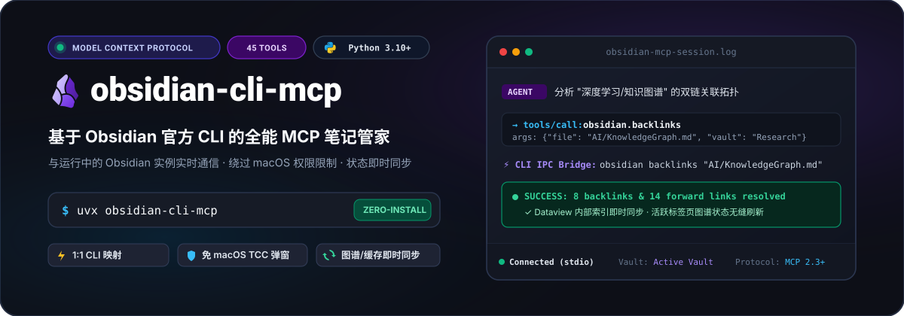
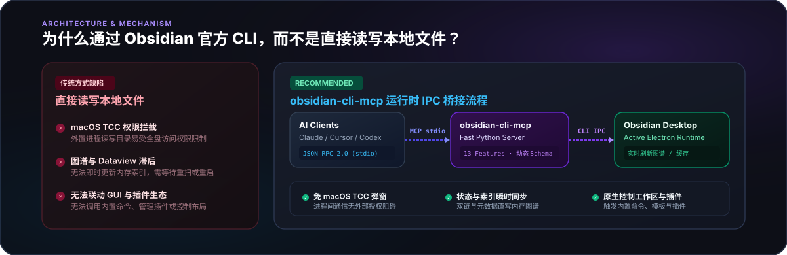
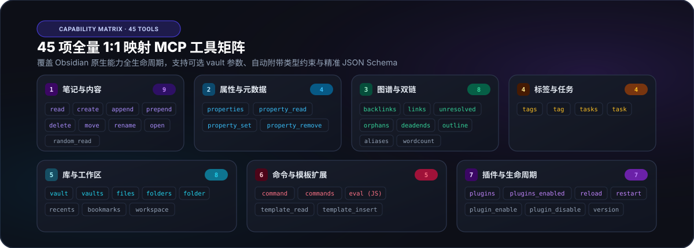

[license]: https://github.com/AkimioJR/obsidian-cli-mcp/blob/main/LICENSE
[license-badge]: https://img.shields.io/badge/License-MIT-blue.svg?style=flat-square
[python]: https://pypi.org/project/obsidian-cli-mcp
[python-badge]: https://img.shields.io/pypi/pyversions/obsidian-cli-mcp?style=flat-square&logo=python&logoColor=white
[pypi]: https://pypi.org/project/obsidian-cli-mcp
[pypi-badge]: https://img.shields.io/pypi/v/obsidian-cli-mcp?style=flat-square&logo=pypi&logoColor=white
[uv]: https://github.com/astral-sh/uv
[uv-badge]: https://img.shields.io/badge/Package-uv%20%2F%20uvx-10B981.svg?style=flat-square
[mcp]: https://modelcontextprotocol.io
[mcp-badge]: https://img.shields.io/badge/Protocol-MCP%202.3+-8B5CF6.svg?style=flat-square
[ci]: https://github.com/AkimioJR/obsidian-cli-mcp/actions/workflows/lint.yaml
[ci-badge]: https://img.shields.io/github/actions/workflow/status/AkimioJR/obsidian-cli-mcp/lint.yaml?branch=main&style=flat-square&logo=githubactions&logoColor=white&label=CI
[release]: https://github.com/AkimioJR/obsidian-cli-mcp/releases/latest
[release-badge]: https://img.shields.io/github/v/release/AkimioJR/obsidian-cli-mcp?style=flat-square
[pr]: https://github.com/AkimioJR/obsidian-cli-mcp/pulls
[pr-badge]: https://img.shields.io/badge/PRs-welcome-brightgreen.svg?style=flat-square
[issue]: https://github.com/AkimioJR/obsidian-cli-mcp/issues/new
[issue-badge]: https://img.shields.io/badge/Issues-welcome-brightgreen.svg?style=flat-square

<div align="center">
  <p>
    
  </p>

[![pypi][pypi-badge]][pypi]
[![python][python-badge]][python]
[![uv][uv-badge]][uv]
[![mcp][mcp-badge]][mcp]
[![ci][ci-badge]][ci]

[![release][release-badge]][release]
[![license][license-badge]][license]
[![pr][pr-badge]][pr]
[![issue][issue-badge]][issue]

  <p>
    <a href="README.md">简体中文</a> | <b>English</b>
  </p>
</div>

---

## 💡 Why obsidian-cli-mcp?

**An MCP (Model Context Protocol) server to interact with Obsidian vaults via the official Obsidian CLI.**

Many AI clients attempt to read and write local Markdown files directly on disk, but this approach introduces significant flaws in real personal knowledge management (PKM) workflows. `obsidian-cli-mcp` connects to the running Obsidian Electron app via official CLI IPC (Inter-Process Communication), completely solving these pain points:

<p align="center">
  
</p>

### Architecture Comparison

| Feature                | Direct File I/O                                              | obsidian-cli-mcp (Official CLI IPC)                                               |
| :--------------------- | :----------------------------------------------------------- | :-------------------------------------------------------------------------------- |
| **Graph Sync**         | ❌ Silent external writes leave backlinks & graph out-of-sync | ✅ **Instant Sync**: Backlinks, forward links & orphans update immediately         |
| **Dataview Cache**     | ❌ In-memory index misses changes, returning stale data       | ✅ **Live Reflection**: Frontmatter property updates trigger instant cache refresh |
| **macOS Permissions**  | ⚠️ Prone to TCC permission prompts or Full Disk Access errors | ✅ **Zero-Permission Friction**: Communicates with running app via CLI, no prompt  |
| **Active Editor Tabs** | ❌ Cannot detect active note or focus editor UI               | ✅ **GUI Integration**: Focus notes with `open`, inspect live outlines, etc.       |
| **Plugins & Commands** | ❌ Cannot interact with Obsidian plugin ecosystem             | ✅ **Extensible**: Trigger internal/plugin commands, toggle plugins, JS `eval`     |

---

## 🚀 Quickstart

### Method 1: Run via `uvx` (Recommended · Zero-Install)

No need to clone code or configure a local Python environment. `uvx` automatically launches the server in a secure, isolated sandbox.

Add this configuration to your Claude Desktop (`claude_desktop_config.json`), Cursor, or Codex (`mcp.json`):

```json
{
  "mcpServers": {
    "obsidian": {
      "command": "uvx",
      "args": ["obsidian-cli-mcp"],
      "env": {
        "OBSIDIAN_VAULT": "MyVault"
      }
    }
  }
}
```

> **Tip**: To run directly from GitHub or pin a specific branch/version:  
> `uvx --from git+https://github.com/AkimioJR/obsidian-cli-mcp.git obsidian-cli-mcp`

---

### Method 2: Install as a Standalone Tool via `uv tool` (High Frequency)

Install into an isolated environment without polluting system Python, generating a global command with sub-second launch speed:

```bash
uv tool install obsidian-cli-mcp
# Or install directly from GitHub main branch:
# uv tool install git+https://github.com/AkimioJR/obsidian-cli-mcp.git
```

In MCP client config, use `uv tool run` (prevents path discovery errors in desktop apps):

```json
{
  "mcpServers": {
    "obsidian": {
      "command": "uv",
      "args": ["tool", "run", "obsidian-cli-mcp"],
      "env": {
        "OBSIDIAN_VAULT": "MyVault"
      }
    }
  }
}
```

> **Upgrading**: Upgrade anytime with a single command: `uv tool upgrade obsidian-cli-mcp`

---

### Method 3: Install via `pip`

You can also install via traditional `pip` into your active Python environment:

```bash
pip install obsidian-cli-mcp
# Or from GitHub:
# pip install git+https://github.com/AkimioJR/obsidian-cli-mcp.git
```

Client configuration:

```json
{
  "mcpServers": {
    "obsidian": {
      "command": "obsidian-cli-mcp",
      "env": {
        "OBSIDIAN_VAULT": "MyVault"
      }
    }
  }
}
```

---

## 🛠️ Prerequisites & Configuration

### Prerequisites

1. **Obsidian Desktop App**:
   - Requires **Obsidian v1.12.7 or higher** (bundled with official CLI interface support; see [Obsidian CLI Changelog](docs/obsidian-cli-changelog.md));
   - Obsidian desktop app must remain running while interacting with this MCP server.
2. **Enable Official Command Line Interface (Obsidian CLI)**:
   - Open Obsidian, go to **Settings** → **About** (or **General** depending on version);
   - Locate and toggle on **Command line interface**;
   - Click **Register** next to *Set up CLI to work in the terminal* to link `obsidian` into your system `$PATH`;
   - Restart your terminal and run `obsidian version` to verify setup (outputting version confirms readiness).

### Environment Variables

| Variable              | Description                                                                                                                                     | Default Behavior                                        |
| :-------------------- | :---------------------------------------------------------------------------------------------------------------------------------------------- | :------------------------------------------------------ |
| `OBSIDIAN_VAULT`      | Target Vault name (automatically used when tool calls omit the `vault` parameter)                                                               | Defaults to currently active vault in Obsidian          |
| `OBSIDIAN_CLI_PATH`   | Absolute path to Obsidian CLI binary                                                                                                            | Auto-detected in system `PATH` (`which obsidian`)       |
| `OBSIDIAN_TIMEOUT`    | CLI subprocess execution timeout in seconds (supports floats, `none`/`null` to disable)                                                         | `30.0`                                                  |
| `OBSIDIAN_VERSION`    | Manually specify/override Obsidian client version (e.g. `1.14.5` for headless/container environments)                                           | Auto-detected from `obsidian version` at startup        |
| `OBSIDIAN_FEATURES`   | Comma-separated feature groups to enable (e.g. `note,property,tag,task,graph,explorer,workspace,command,template,plugin,base,developer` or presets `standard,safe,all`) | `standard` (default: core tools plus standard features) |
| `OBSIDIAN_LANG`       | Localization language for human-readable tool titles (supports `zh_CN`, `en_US`)                                                                | Auto-detected from system locale (fallback to `en_US`)  |
| `OBSIDIAN_EXTENSIONS` | Whether to enable non-native composite extension tools (only accepts `true` case-insensitively; any other value is `false`)                     | `false` (defaults to pure official CLI tools only)      |

---

## 📦 Supported MCP Tools Matrix

All tools support an optional `vault` parameter for multi-vault switching. All tool parameters come with strict type definitions and exact JSON Schema constraints.

<p align="center">
  
</p>

<details open>
<summary><b>Expand to view detailed tool catalog</b></summary>

### 🌟 Core Tools (Core · 5 native + 1 extension, always loaded by default)
- `version`: Query installed Obsidian desktop application version.
- `vaults`: List all known Obsidian vaults and their local absolute paths.
- `vault`: Query current Vault stats (name, path, total files, size, etc.).
- `reload`: Reload current vault interface and re-index notes.
- `restart`: Restart Obsidian desktop application.
- `set_default_vault`: Dynamically switch default target vault for the session (requires `OBSIDIAN_EXTENSIONS=true`).

### 1. Notes & Content (Feature: `note` · 11 native + 2 extensions)
- `read`: Read raw Markdown content by note name or relative path.
- `create`: Create a new note with optional template, pre-filled content, overwrite, and auto-open.
- `append`: Append content to the end of a note or under a target heading section (`heading=`, Obsidian 1.14+).
- `prepend`: Prepend content to the beginning of a note or under a target heading section (`heading=`, Obsidian 1.14+).
- `delete`: Delete a note (defaults to system trash, supports permanent deletion).
- `move`: Move or rename note path.
- `rename`: Rename a note file (requires Obsidian 1.12.1+).
- `open`: Focus and open note in the Obsidian GUI.
- `random_read`: Randomly read a note from the vault.
- `random`: Open and focus a randomly chosen note in Obsidian GUI.
- `diff`: List or diff local history and Obsidian Sync versions for a file.
- `edit`: Precise in-place note editing via literal search-and-replace (requires `OBSIDIAN_EXTENSIONS=true`).
- `import_file`: Import external local file directly into vault (zero token overhead, avoids JSON escaping, requires `OBSIDIAN_EXTENSIONS=true`).

### 2. Properties & Frontmatter (Feature: `property` · 4 tools)
- `properties`: List all property keys across vault or for a specific file.
- `property_read`: Read specific Frontmatter property value.
- `property_set`: Set property value (supports text, list, number, checkbox).
- `property_remove`: Remove a property from frontmatter.

### 3. Graph & Links (Feature: `graph` · 8 tools)
- `backlinks`: Get note backlink incoming edges (JSON format).
- `links`: Get outgoing link edges from a note.
- `unresolved`: List hanging links with no target note created yet.
- `orphans`: List orphan notes with zero incoming backlinks.
- `deadends`: List dead-end notes with zero outgoing links.
- `outline`: Get heading outline hierarchy (JSON format).
- `aliases`: List all aliases for the vault or note.
- `wordcount`: Get character and word count statistics.

### 4. Tags (Feature: `tag` · 2 tools)
- `tags`: Get all tags and their frequency distribution (JSON format).
- `tag`: Query specific tag occurrences across notes.

### 5. Tasks (Feature: `task` · 2 tools)
- `tasks`: Filter tasks by status (completed/todo), tag, or file.
- `task`: Toggle checkbox state or mark task completed.

### 6. File Explorer & Resources (Feature: `explorer` · 5 tools)
- `files`: List files in vault (supports folder/extension filters).
- `file`: Show metadata and system details for a specific file.
- `folders` / `folder`: Inspect directory tree structure and metadata.
- `recents`: List recently accessed files.

### 7. Workspace & Navigation (Feature: `workspace` · 5 tools)
- `workspace`: Query workspace window layout tree.
- `tabs`: List all open tabs and workspace splits.
- `tab_open`: Open a new tab in Obsidian GUI (supports file, tab group ID, or view type).
- `bookmarks`: Read bookmarked and starred items.
- `bookmark`: Add a bookmark in the vault (supports file, subpath, folder, search query, or URL).

### 8. Commands & Command Palette (Feature: `command` · 2 tools)
- `command`: Trigger internal Obsidian or plugin commands.
- `commands`: List all available command IDs.

### 9. Templates & Automation (Feature: `template` · 3 tools)
- `templates`: List all template files in the vault.
- `template_read`: Read template file with variable evaluation.
- `template_insert`: Insert template into currently active note.

### 10. Plugin Management (Feature: `plugin` · 4 tools)
- `plugins` / `plugins_enabled`: List installed / active community and core plugins.
- `plugin_enable` / `plugin_disable`: Dynamically enable or disable plugins.

### 11. Database Views & Bases (Feature: `base` · 4 tools, requires Obsidian 1.14+)
- `bases`: List all `.base` database view files in the vault.
- `base_views`: List all views configured in a `.base` file.
- `base_query`: Query structured records from a Base file (JSON, CSV, Markdown, etc.).
- `base_create`: Create a new entry in a Base file.

### 12. Developer Tools (Feature: `developer` · 11 tools)
- `eval`: Execute JavaScript code inside Obsidian runtime (advanced escape hatch).
- `dev_dom`: Query, filter, and extract rendered DOM elements via CSS selectors (text, HTML, attributes, CSS).
- `dev_css`: Inspect CSS rules and source locations for matching selectors.
- `dev_console`: View or clear captured console messages (Log/Warn/Error/Info/Debug).
- `dev_errors`: View or clear uncaught runtime exceptions and error logs.
- `dev_debug`: Attach or detach the Chrome DevTools Protocol debugger channel (`state=on|off`).
- `dev_startup`: Inspect startup performance breakdown (parsed as structured JSON).
- `dev_screenshot`: Capture an application window screenshot and save to disk.
- `dev_mobile`: Toggle mobile emulation mode (`state=on|off`).
- `devtools`: Toggle the Electron native developer tools window (F12).
- `dev_cdp`: Directly execute Chrome DevTools Protocol (CDP) commands.

</details>

---

## 💻 Local Development

To contribute or customize this project:

### 1. Clone & Sync Dependencies

```bash
git clone https://github.com/AkimioJR/obsidian-cli-mcp.git
cd obsidian-cli-mcp

# Fast sync with uv
uv sync
```

### 2. Run Local Server

```bash
uv run obsidian-cli-mcp
```

### 3. Client Config for Development

Point client directly to local source tree:

```json
{
  "mcpServers": {
    "obsidian": {
      "command": "uv",
      "args": [
        "--directory",
        "/absolute/path/to/obsidian-cli-mcp",
        "run",
        "obsidian-cli-mcp"
      ],
      "env": {
        "OBSIDIAN_VAULT": "MyVault"
      }
    }
  }
}
```

### 4. Automated Testing & Code Quality

```bash
# Run pytest unit tests
uv run pytest

# Type checking
uv run ty check src tests

# Code format & lint
uv run ruff format .
uv run ruff check .
```

---

## 📝 Changelog

For detailed release history and changes, please refer to [CHANGELOG.md](docs/CHANGELOG.md).

---

## 📄 License

This project is licensed under the [MIT License](LICENSE). Contributions, bug reports, and PRs are welcome!
